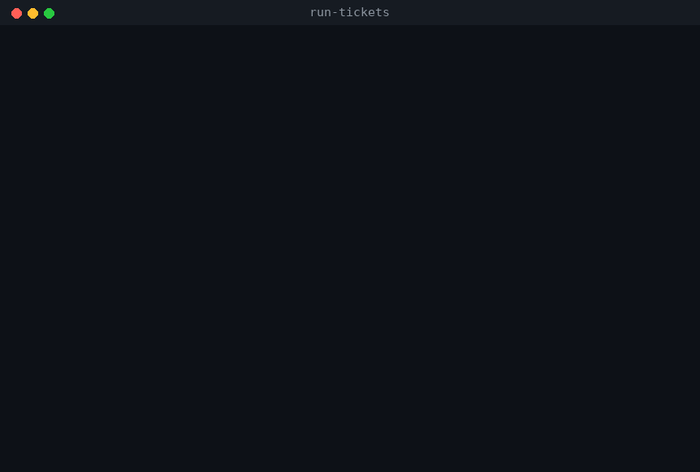

# run-tickets

[](https://github.com/omanei/run-tickets/actions/workflows/test.yml)


[](https://pypi.org/project/run-tickets/)
[](LICENSE)

[English](README.md) | **Русский**

Ночной исполнитель тикетов для процесса скиллов [Matt Pocock](https://github.com/mattpocock/skills):
`/to-spec` → `/to-tickets` → **run-tickets** → готовая ветка в вашем репозитории.

Раннер берёт тикеты фичи по одному в порядке блокеров. На каждый тикет он запускает агента
два раза, каждый раз с чистым контекстом:
- `implement`;
- `code-review` с исправлением находок, отметкой галочек и `Status: done`. Если implement не
  сделал коммитов (отчёт, прогон стенда, заведение тикетов), ревьюить нечего, и вместо
  ревью идёт шаг `verify`: проверка результата по критериям тикета.

После каждого шага раннер сам проверяет репозиторий и прогоняет тесты проекта. Когда все
тикеты готовы, проводится финальное ревью всей фичи. Всё происходит локально: в итоге в
репозитории появляется ветка с коммитами, а пушить её или нет, решаете вы. Если раннер упал,
его можно запустить снова, и он продолжит с того же шага.

Зачем это нужно, если агент может сам, — подробнее и чтобы поделиться:
[docs/why.ru.md](https://github.com/omanei/run-tickets/blob/master/docs/why.ru.md).

```
 следующий тикет ─▶ implement ─▶ проверки + тесты ─▶ review ─▶ проверки + тесты ─▶ done
        ▲              │ провал: повтор │ лимит провайдера: ждать           │
        └──────────────┴────────────────┴──── state.json хранит шаг и базу ─┘
 все тикеты done ─▶ финальное ревью фичи ─▶ тесты ─▶ ветка feat/… в репозитории ─▶ уведомление
```



*Настоящий терминал раннера, вместо модели работает демо-агент. На тикете 02 агент сообщает,
что всё готово, но оставляет критерий неотмеченным. Раннер это видит и перезапускает шаг.
Строка внизу показывает, что идёт сейчас и сколько фичи уже сделано.*

- Работает на **Linux, macOS и Windows**: нужны Python 3.9+ и git. Установщик сам ставит
  единственную библиотеку, `rich`, для подсветки кода и таблиц. Скопированный файл работает
  и без неё.
- Агенты: **omp, pi, Claude Code, Codex, Gemini CLI, Qwen Code, opencode, Kilo, Cursor, Amp,
  Droid, Copilot CLI, goose** и любой другой через конфиг. Каждому шагу можно
  дать своего агента и свою модель.

## Быстрый старт

```bash
# 1. Установить один раз (нужен uv: https://docs.astral.sh/uv/; или: pipx install run-tickets)
uv tool install run-tickets

# 2. В корне проекта создать конфиг и проверить, что получилось
cd ~/work/my-project
run-tickets init --agent omp
run-tickets config .scratch/my-feature --prompts

# 3. Запустить
run-tickets run .scratch/my-feature
```

Утром выполните `run-tickets report .scratch/my-feature --open`: весь прогон на одной
странице. `run-tickets status .scratch/my-feature` показывает то же в терминале.

**Попробовать без модели:** склонируйте репозиторий и выполните `python examples/demo.py`.
Демо создаёт временный git-репозиторий с примером фичи (`examples/demo`: спека и три тикета)
и прогоняет её с демо-агентом. Ваши репозитории не затрагиваются.

## Установка

Класть скрипт в определённую папку не нужно. Раннеру передаётся путь к каталогу фичи, а
git-репозиторий он находит сам по этому пути. Запускать его можно из любого каталога.

### 1. Как команду: рекомендуется

```bash
uv tool install run-tickets      # или:
pipx install run-tickets
```

| | uv | pipx |
|---|---|---|
| обновить | `uv tool upgrade run-tickets` | `pipx upgrade run-tickets` |
| удалить | `uv tool uninstall run-tickets` | `pipx uninstall run-tickets` |

- Конкретная версия: `uv tool install run-tickets==0.5.0`. Свежий, ещё не выпущенный код из
  `master`: `uv tool install git+https://github.com/omanei/run-tickets` (или `pipx install
  git+https://github.com/omanei/run-tickets`).
- Если после установки команда не находится, выполните `uv tool update-shell` или
  `pipx ensurepath` и перезапустите терминал.

### 2. Без установки

```bash
uvx run-tickets run .scratch/my-feature
```

### 3. Одним файлом в проекте

Скопируйте `run_tickets.py` в репозиторий, например в `scripts/run_tickets.py`, и
закоммитьте. Тогда у всей команды будет одна версия раннера.

```bash
python scripts/run_tickets.py run .scratch/my-feature     # Windows: py scripts\run_tickets.py …
uv run scripts/run_tickets.py run .scratch/my-feature     # uv сам подберёт Python
```

Зависимости указаны прямо в файле ([PEP 723](https://peps.python.org/pep-0723/)), и
`uv run` поставит их сам: `rich`, а для Python ниже 3.11 ещё `tomli`. С обычным `python`
ничего ставить не нужно. Без `rich` блоки кода не подсвечиваются, а таблицы рисуются проще.
Без `tomli` (только на Python ниже 3.11) не прочитать файл конфига.

## Использование

```bash
run-tickets run    <feature> [<feature> …]  # до конца, до блокировки, паузы или остановки
run-tickets run    <feature> --once         # ровно один тикет
run-tickets status <feature> [--watch]      # что сделано, что идёт сейчас, где и почему встал
run-tickets config <feature> [--prompts]    # итоговые настройки, команды агентов, промпты
run-tickets retry  <feature> 05             # повторить шаг, на котором встал тикет 05
run-tickets reset  <feature> 05             # сделать 05 заново с нуля
run-tickets skip   <feature> 05 --reason …  # пометить 05 как wontfix с комментарием
run-tickets adopt  <feature> --feature-base <sha> [--resume 16:review:<sha>]  # перенять фичу
run-tickets report <feature> [--open]       # runs/report.html: весь прогон на одной странице
run-tickets init   [--agent claude]         # создать .ticket-runner.toml в корне репозитория
```

У `run` и `config` есть флаги, которые важнее конфига:

| Флаг | Что делает |
|---|---|
| `--agent`, `--model` | агент и модель для всех шагов |
| `--max-time 2h` | лимит времени на шаг |
| `--retries 1` | сколько раз повторять проваленный шаг |
| `--test-command "make test"` | команда тестов |
| `--branch feat/{{feature}}` | ветка для работы |
| `--worktree` | работать в отдельном `git worktree` |
| `--no-final-review` | без финального ревью фичи |
| `--pause-after 03` | остановиться после тикета 03 |
| `--config <файл>` | взять конфиг из указанного файла |
| `--ui live` / `--ui plain` | живой вид или простые строки (работает и для `status`) |

Только у `run`:
- `--keep-going`: при очереди фич переходить к следующей после остановки;
- `--adopt-dirty`: после падения продолжить с незакоммиченными правками агента;
- `--no-input`: никогда не задавать вопросов в терминале (что делать с такими правками);
- `--dry-run`: то же, что `status`.

`retry`, `reset` и `skip` понимают номер (`5`, `05`) и имя (`05-slug`). С аргументом `final`
они относятся к финальному ревью.

Коды выхода:

| Код | Значение |
|---|---|
| `0` | все тикеты сделаны |
| `1` | остановка на проверке |
| `2` | ошибка запуска |
| `3` | запускать нечего, но открытые тикеты остались |
| `4` | пауза по `pause_after` |
| `130` | прервано |

### Что видно в терминале

В терминале раннер показывает живой вид:
- заголовок у каждого тикета и каждого шага;
- вывод агента с отрисованным markdown: заголовки, списки, чекбоксы, блоки кода с подсветкой
  синтаксиса, таблицы в рамке и цветные диффы. Подсветку и рамки рисует
  [rich](https://github.com/Textualize/rich), если он установлен, а при установке через uv или
  pipx он ставится сам. У агентов, которые отдают поток JSON-событий,
  каждый вызов инструмента появляется отдельной строкой в момент запуска (`▸ bash  npm test`);
- строку в конце каждого шага: прошёл он или нет и почему;
- строку статуса внизу: тикет, шаг, попытка, сколько идёт шаг, сколько агент молчит,
  стоимость и прогресс по фиче (`✓01 ●02 ○03`);
- рамку в конце: готово, остановлено, пауза или нечего запускать — с командой, чтобы продолжить.

Если вывод идёт в файл или в pipe (`> run.out`, CI), раннер печатает простые строки без
escape-кодов, чтобы лог нормально читался. Режим можно задать явно: `--ui live` или
`--ui plain`, ключ `ui = "..."` в конфиге или переменная `RUN_TICKETS_UI`. `NO_COLOR=1`
оставляет живой вид, но без цветов.

### Ночной запуск

Агент работает часами. Раннер должен пережить закрытие терминала, а машина не должна уснуть:

```bash
# macOS
nohup caffeinate -i run-tickets run .scratch/my-feature > run.out 2>&1 &
# Linux
nohup systemd-inhibit run-tickets run .scratch/my-feature > run.out 2>&1 &
# Windows (PowerShell): отключите сон в настройках электропитания и оставьте окно открытым
run-tickets run .scratch\my-feature
```

Посмотреть, что раннер делает прямо сейчас, можно из другого терминала:
`run-tickets status .scratch/my-feature --watch`. Там видно текущий шаг, сколько он идёт и
последнее действие агента.

Если что-то оборвалось, запустите ту же команду ещё раз.

Несколько фич выполняются по очереди одной командой:
`run-tickets run .scratch/feat-a .scratch/feat-b`.

## Полностью автоматический режим

Конфиг, который проводит фичу от тикетов до готовой ветки без участия человека:

```toml
agent = "claude"
test_command = "make test"          # раннер сам гоняет тесты после каждого шага

branch = "feat/{{feature}}"
worktree = true                     # ваша рабочая копия не трогается всю ночь
worktree_setup = ['cp "$RUN_TICKETS_MAIN_REPO/.env" .', "make deps"]

max_cost = 50                       # долларов за ночь (агенты, сообщающие стоимость)
protected = ["migrations/", ".github/"]
notify_command = 'curl -s -X POST -H "Content-type: application/json" --data "{\"text\": \"$RUN_TICKETS_MESSAGE\"}" "$SLACK_WEBHOOK_URL"'
```

Готовые конфиги для каждого агента и для частых случаев лежат в
[`examples/configs/`](https://github.com/omanei/run-tickets/tree/master/examples/configs).

## Рецепты

Короткие конфиги под частые устройства проекта. Каждый блок — фрагмент `.ticket-runner.toml`:
добавьте к нему агента и остальные настройки, а результат проверьте командой
`run-tickets config <папка фичи>`.

### Тесты в Docker

Если тестам нужны база или другие сервисы, пусть их гоняет свежий контейнер из рабочей копии
раннера:

```toml
test_command = "docker compose run --rm app pytest -q"
preflight = ["docker info"]          # Docker не запущен — стоп до старта агента
```

`docker compose run` читает compose-файл из рабочей копии, поэтому bind mount на `.`
монтирует код, который только что написал агент. Так работает и с `worktree = true`. С
долгоживущим контейнером иначе. Если тесты идут в контейнере, запущенном из основной копии
(`docker compose exec app pytest`), он видит код вашей копии. В worktree изменения агента
вообще не проверялись бы. Тогда оставьте `worktree = false`:

```toml
branch = "feat/{{feature}}"
worktree = false                     # контейнер смонтирован на эту копию
test_command = "docker compose exec -T app pytest -q"   # -T: у раннера нет терминала
preflight = ["docker compose ps --status running --services | grep -q app"]
```

### Монорепозиторий, где меняется один пакет

```toml
test_command = "cd packages/api && npm test"   # запускается из корня репозитория
extra_instructions = "This feature changes only packages/api. Do not edit other packages."
protected = ["packages/web/"]        # агент тронул — раннер останавливается
```

Команды выполняются в корне рабочей копии. Если фичи трогают разные пакеты, положите конфиг в
папку каждой фичи. Он важнее конфига в корне репозитория, а файлы не сливаются, так что в нём
должен быть весь конфиг.

### Node или Python в worktree

В новом worktree есть только файлы под git. `worktree_setup` один раз, до первого шага,
доносит остальное: `.env` из вашей копии (`$RUN_TICKETS_MAIN_REPO`) и зависимости. Если
настройка упала, запуск останавливается, а в следующий раз она повторяется.

```toml
# Node
worktree = true
worktree_setup = ['cp "$RUN_TICKETS_MAIN_REPO/.env" .', "npm ci"]
test_command = "npm test"
```

```toml
# Python с uv
worktree = true
worktree_setup = ['cp "$RUN_TICKETS_MAIN_REPO/.env" .', "uv sync"]
test_command = "uv run pytest -q"
```

### Уведомления в Slack или Telegram

`notify_command` запускается при остановке, паузе и в конце, текст в одну строку — в
`$RUN_TICKETS_MESSAGE`. Токены берутся из окружения, в котором запущен раннер.

```toml
# Slack: incoming webhook
notify_command = 'curl -s -X POST -H "Content-type: application/json" --data "{\"text\": \"$RUN_TICKETS_MESSAGE\"}" "$SLACK_WEBHOOK_URL"'
```

```toml
# Telegram: токен бота от @BotFather и id вашего чата
notify_command = 'curl -s "https://api.telegram.org/bot$TELEGRAM_BOT_TOKEN/sendMessage" -d chat_id="$TELEGRAM_CHAT_ID" --data-urlencode text="$RUN_TICKETS_MESSAGE"'
```

### Несколько фич за один запуск

```bash
run-tickets run .scratch/feat-a .scratch/feat-b --keep-going
```

```toml
branch = "feat/{{feature}}"          # своя ветка на фичу
worktree = true                      # каждая ветка начинается от коммита вашей копии
```

Фичи идут одна за другой, у каждой своё состояние, ветка и сводка. Остановка или пауза
заканчивают запуск на этой фиче, а с `--keep-going` раннер переходит к следующей. С
`worktree = true` ветки независимы. Без worktree ваша копия к старту feat-b ещё стоит на
ветке feat-a, и ветка feat-b растёт из неё. Это то, что нужно, когда feat-b опирается на
feat-a.

## Возможности

### Тесты запускает раннер, а не агент

Если задан `test_command`, раннер сам запускает его после каждого шага. Если тесты не прошли,
шаг считается проваленным. При повторе агент получает конец вывода тестов.

Перед первым шагом тикета тесты прогоняются ещё раз, для базовой проверки (`test_baseline`).
Если они падают уже там, раннер останавливается до запуска агента: виноваты база или
окружение, а не агент. Лимит времени на тесты — `test_timeout`.

### Лимиты провайдера

Агент может упасть из-за исчерпанного лимита: «usage limit», «rate limit», «429» и т. п. В этом
случае раннер не тратит попытку, а ждёт и перезапускает тот же шаг. Время ожидания берётся из
сообщения агента: «resets 3am», «try again in 15 minutes», метка времени и т. п. Если в
сообщении его нет, раннер ждёт `limit_default_wait`. Суммарное ожидание на шаг ограничено
`limit_max_wait`.

### Ветка и worktree: всё локально

Раннер ничего не пушит и никуда не ходит, кроме вашего агента. Результат — ветка в вашем
репозитории.

- `branch = "feat/{{feature}}"` — работать в отдельной ветке. Раннер создаёт её от текущей.
- `worktree = true` — работать в отдельном `git worktree`, по умолчанию в
  `../<repo>-worktrees/<feature>`. Worktree — это вторая рабочая папка того же репозитория:
  история и ветки общие, но ваша рабочая копия, ваша ветка и stash всю ночь недоступны агенту.
  Вы можете продолжать работать в своей копии.
- `worktree_setup` — команды, которые один раз выполняются в новом worktree. Там есть только
  отслеживаемые файлы, поэтому `.env`, зависимости и виртуальное окружение нужно принести
  отдельно. Если команда упала, раннер повторит её при следующем запуске.
- Когда все тикеты и финальное ревью готовы, раннер удаляет папку worktree, а ветка
  остаётся в репозитории. Если в worktree остались незакоммиченные файлы, папка не удаляется,
  а в отчёте написано, что в ней осталось. Пока работа не закончена, worktree остаётся на
  месте, чтобы следующий запуск продолжил с того же шага.

В конце раннер подсказывает, что делать с веткой:

```bash
git log --oneline main..feat/my-feature    # что сделано
git diff main...feat/my-feature            # весь diff
git merge feat/my-feature                  # влить локально
git push -u origin feat/my-feature         # или отправить на сервер и открыть PR самому
```

Тикеты и `runs/` всегда лежат в вашей рабочей копии, а код пишется в рабочем дереве раннера.

> **Когда `worktree = true` не подходит.** Проверьте, где ваш проект гоняет тесты. Если в
> Docker-контейнере, который монтирует основную рабочую копию (volume на папку
> репозитория), то и агент, и `test_command`, и `preflight` запустят тесты внутри контейнера.
> А там лежит код вашей копии, а не worktree. Тесты будут зелёными на старом коде, и раннер
> примет непроверенную работу. Для таких проектов оставьте `worktree = false` и работайте в
> ветке (`branch = "feat/{{feature}}"`) в основной копии. Другой вариант — поднять для
> worktree свой контейнер, смонтированный на папку worktree (через `worktree_setup` и
> `test_command`).

### Тикеты без кода: шаг verify

Результат некоторых тикетов лежит вне git: отчёт, прогон стенда, новые тикеты. Implement
такого тикета может закончиться без коммитов, и это не провал. Если между базой тикета и
HEAD нет коммитов, раннер вместо code-review запускает шаг `verify`. Агент с чистым
контекстом читает тикет, его `## Comments` и все файлы, которые тот называет. Затем он
сверяет каждый `- [ ]` с тем, что есть на самом деле (слова implement доказательством не
считаются), отмечает выполненное, доделывает недостающее и ставит `done` или `needs-info`.

После verify раннер проверяет то же, что после review: статус `done`, ни одного `- [ ]`,
чистое дерево, тесты.

Строка `**Kind:** report` в тикете отправляет его на verify всегда, даже если implement что-то
закоммитил (например, сам файл отчёта). Агент implement тогда получает в промпте пометку, что
результат тикета — отчёт, а не код.

У шага verify те же агент и модель, что у review. Отдельно их можно задать в
`[steps.verify]`.

### Финальное ревью фичи

Каждый тикет проверяется отдельно, и стыки между тикетами в эти проверки не попадают. Поэтому
после последнего тикета раннер запускает ещё одно ревью (`final_review = true`, по умолчанию
включено). Оно смотрит изменения `since <база фичи>` против `spec.md`:
- что из спеки не покрыл ни один тикет;
- несостыковки и дубли между тикетами;
- забытую связку частей.

Затем агент прогоняет все тесты. Раннер проверяет результат финального ревью так же, как
обычный шаг. Повторно оно не запускается, пока HEAD не изменился.

### Разные агенты и модели на шаги

```toml
[steps.implement]
model = "opus"
[steps.review]
agent = "codex"        # ревью другой моделью находит то, что автор пропустил
max_time = "1h"
[steps.final]
model = "opus"
```

### Бюджет

- `max_cost` — сколько долларов можно потратить за запуск. Когда бюджет исчерпан, следующий
  шаг не начинается.
- `max_step_cost` — лимит на один шаг. Передаётся агенту, если тот принимает такой флаг
  (у `claude` это `--max-budget-usd`).

Стоимость сообщают `claude`, `omp`, `pi`, `opencode` и `kilo`. Она видна в REPORT.md и SUMMARY.md.
`run-tickets config` предупреждает, если у выбранного агента бюджет не работает.

### Защищённые пути и ослабленные тесты

- `protected = ["migrations/", ".github/", "*.lock"]` — если агент тронул такой путь, раннер
  сразу останавливается, без повтора.
- В отчёте раннер выделяет добавленные `skip`, `xfail`, `@Disabled`,
  `#[ignore]`. Ещё он выделяет строки тестов, где поменялось только число (поднятый порог или
  лимит), например `BUDGET = 100 -> BUDGET = 200`.

### Пауза для человека

`pause_after = ["03"]` или `--pause-after 03` останавливает раннер после тикета 03: можно
посмотреть промежуточный результат. Раннер выходит с кодом 4. Следующий запуск продолжает со
следующего тикета.

### Утренняя сводка и уведомления

`runs/SUMMARY.md` обновляется после каждого тикета и в конце. В нём итог, сколько тикетов
сделано, стоимость, ветка и таблица по тикетам.

Уведомления приходят коротким сообщением, например: «my-feature: 7/9 done; stopped - at
08-export (review): …; $12.30».
- Локально: macOS, `notify-send` или всплывающее окно Windows.
- Куда угодно: через `notify_command`. Текст сообщения в `$RUN_TICKETS_MESSAGE`, пути к
  сводке и отчёту в `$RUN_TICKETS_SUMMARY` и `$RUN_TICKETS_REPORT`.

### Чистка логов

При каждом запуске раннер удаляет из `runs/` логи, транскрипты, сессии и промпты старше
`log_retention` (по умолчанию 30 дней). Если `runs/` больше `log_max_mb`, раннер удаляет и
более свежие файлы, начиная с самых старых, но не моложе суток. `REPORT.md`, `SUMMARY.md`,
`state.json` и `events.jsonl` не удаляются никогда.

## Настройка

Всё настраивается в одном файле **`.ticket-runner.toml`**. Обычно он лежит в корне
репозитория и коммитится, тогда настройки общие для команды. Если фиче нужны свои настройки,
положите отдельный файл в её каталог.

Где раннер ищет конфиг, по убыванию приоритета:

1. флаги командной строки;
2. файл из `--config <путь>`;
3. `<каталог фичи>/.ticket-runner.toml`;
4. `<корень репозитория>/.ticket-runner.toml`;
5. значения по умолчанию.

Файлы не сливаются: раннер берёт первый найденный.

- `run-tickets init` создаёт файл, где все ключи с умолчаниями закомментированы и объяснены.
- В [`examples/configs/`](https://github.com/omanei/run-tickets/tree/master/examples/configs)
  лежат готовые конфиги для каждого агента и для частых случаев, а в [Рецептах](#рецепты) —
  фрагменты для Docker, монорепозитория, worktree и уведомлений.
- `run-tickets config <feature>` показывает, какой файл подхватился, откуда взялось каждое
  значение и какой командой будет запущен агент на каждом шаге.
- Если в конфиге опечатка в ключе, раннер не запустится, а не проигнорирует её молча.

### Ключи

| Ключ | По умолчанию | Что делает |
|---|---|---|
| `agent` | `"omp"` | `omp`, `pi`, `claude`, `codex` или имя из `[agents.<имя>]` |
| `model` | `""` | модель, передаётся агенту (если задана) |
| `max_time` | `"3h"` | лимит на шаг; потом раннер убивает агента со всеми дочерними процессами |
| `retries` | `1` | сколько раз повторить проваленный шаг в новом процессе |
| `retry_delay` | `"1m"` | пауза перед повтором |
| `test_command` | `""` | тесты, которые раннер запускает сам после каждого шага |
| `test_timeout` | `"30m"` | лимит на прогон тестов |
| `test_baseline` | `true` | прогонять тесты и перед тикетом |
| `limit_wait` | `true` | ждать снятия лимита провайдера вместо остановки |
| `limit_default_wait` | `"30m"` | сколько ждать, если агент не назвал время сброса |
| `limit_max_wait` | `"12h"` | предел ожидания на шаг |
| `branch` | `""` | ветка, например `"feat/{{feature}}"`; пусто = текущая |
| `worktree` | `false` | работать в отдельном `git worktree`; в конце он удаляется, ветка остаётся |
| `worktree_dir` | `"{{repo}}/../{{repo_name}}-worktrees/{{feature}}"` | где он лежит |
| `worktree_setup` | `[]` | команды для нового worktree |
| `final_review` | `true` | финальное ревью всей фичи |
| `pause_after` | `[]` | после каких тикетов остановиться |
| `max_cost` | `0` | долларов за запуск; `0` — без лимита |
| `max_step_cost` | `0` | долларов на шаг, для агентов с флагом бюджета |
| `protected` | `[]` | пути, которые агенту трогать нельзя |
| `log_retention` | `"30d"` | сколько хранить логи; `"0"` — всегда |
| `log_max_mb` | `2000` | предел размера `runs/` |
| `report_heading` | `"Step report"` | заголовок отчёта модели, например `"Отчёт о шаге"` |
| `report_language` | `"English"` | язык отчёта, например `"Russian"` |
| `preflight` | `[]` | команды, которые должны пройти перед стартом и перед каждым тикетом |
| `notify_command` | `""` | команда уведомления |
| `desktop_notify` | `true` | системные уведомления |
| `ui` | `"auto"` | `live` (цвета, отрисованный markdown, строка статуса), `plain` или `auto`: live в терминале, plain при выводе в pipe |
| `extra_instructions` | `""` | правила проекта для implement и review |
| `review_extra_instructions` | `""` | правила только для review (и verify) |
| `final_review_extra_instructions` | `""` | правила для финального ревью |
| `[skills] implement`, `review` | `"implement"`, `"code-review"` | имена скиллов; у плагинов Claude Code с префиксом: `"<плагин>:code-review"` |
| `[steps.<шаг>]` | — | `agent`, `model`, `max_time` для `implement`, `review`, `verify` (по умолчанию как у `review`) или `final` |
| `[agents.<имя>]` | пресеты | своя команда агента |
| `[prompts]` | встроенные | полная замена шаблонов `common`, `implement`, `review`, `verify`, `final` |

### Агенты

| `agent` | Что запускается | Вызов скилла |
|---|---|---|
| `omp` | `omp -p --mode json --auto-approve --session-dir … --cwd … "<prompt>"` | `/skill:implement …` |
| `pi` | `pi -p --mode json --session-dir … "<prompt>"` | `/skill:implement …` |
| `claude` | `claude -p --output-format stream-json --verbose --permission-mode bypassPermissions`, промпт через stdin | `/implement …` |
| `codex` | `codex exec --dangerously-bypass-approvals-and-sandbox -C … -` | текстом |
| `gemini` | `gemini --approval-mode yolo --skip-trust --output-format stream-json -p "<prompt>"` | текстом |
| `qwen` | `qwen --yolo --output-format stream-json -p "<prompt>"` | `/implement …` |
| `opencode` | `opencode run --format json --dangerously-skip-permissions "<prompt>"` | текстом |
| `kilo` | `kilo run --format json --dangerously-skip-permissions "<prompt>"` | текстом |
| `cursor` | `cursor-agent -p --force --output-format stream-json "<prompt>"` | текстом |
| `amp` | `amp --dangerously-allow-all --stream-json -x "<prompt>"` (`model` — это режим: smart, rush, deep) | текстом |
| `droid` | `droid exec --auto high "<prompt>"` | текстом |
| `copilot` | `copilot --allow-all-tools --no-ask-user -p "<prompt>"` | текстом |
| `goose` | `goose run --no-session -t "<prompt>"` | текстом |

`omp`, `pi` и `claude` — пресеты, которыми пользуются каждый день. Остальные
экспериментальные: они собраны по документации каждого инструмента, и какой-то флаг мог с
тех пор измениться. `run-tickets config` показывает точную команду и предупреждает об этом.
Если флаг не тот, задайте команду в `[agents.<name>]` (ниже) и, пожалуйста, откройте issue.
Вызовы инструментов видны вживую у `omp`, `pi`, `claude`, `gemini`, `qwen`, `opencode`,
`kilo`, `cursor` и `amp`: они отдают поток JSON-событий. Стоимость сообщают `omp`, `pi`,
`claude` и `opencode`/`kilo`.

От агента нужны три вещи: неинтерактивный режим, отсутствие вопросов на подтверждение и
установленные скиллы. Свой агент или изменённый пресет задаётся так:

```toml
[agents.my-agent]
command = ["my-agent", "--yes", "--workdir", "{{repo}}", "{{model_args}}", "{{prompt}}"]
model_args = ["--model", "{{model}}"]   # на место {{model_args}}, только если задана model
budget_args = []                         # на место {{budget_args}}, если задан max_step_cost
prompt_via = "arg"                       # "arg" или "stdin"
skill_format = "/{{skill}} {{args}}"     # как агент вызывает скилл
output = "text"                          # или claude-stream-json, pi-json, gemini-json, opencode-json
markdown = true                          # false: в живом виде вывод показывается как есть
export_command = []                      # выгрузка HTML-транскрипта, если есть
```

## Формат тикетов

Формат такой, какой пишет `/to-tickets` при локальном трекере:

```
.scratch/<feature>/
  spec.md
  issues/01-<slug>.md, 02-<slug>.md, …
  runs/            ← создаёт раннер
```

```markdown
# 02: Пользователь экспортирует отчёт

**What to build:** …

**Blocked by:** 01

**Status:** ready-for-agent

- [ ] Критерий приёмки 1
- [ ] Критерий приёмки 2
```

**Статус.** Раннер понимает три записи: `**Status:** x`, `**Status**: x` и `Status: x`.

**Тип.** Необязательная строка `**Kind:** report` помечает тикет, результат которого не код
(см. «Тикеты без кода: шаг verify»).

**Блокеры.**
- **Номером:** `04`, `#4`, `03-slug`. Номера задач вида `PROJ-1234` за блокеры не считаются.
- **Названием тикета:** `/to-tickets` так тоже пишет.
- **Разделом `## Blocked by`** со списком.
- **Без блокеров:** `None (can start immediately)`.
- **Нераспознанный текст:** тикет ждёт и не запускается раньше времени, а `status`
  показывает этот текст.

**Порядок.** Запускается тикет со статусом `ready-for-agent`, у которого все блокеры в `done`.
Если таких несколько, первым идёт тикет с меньшим номером.

**Открытые тикеты.** Тикеты в `needs-info`, `needs-triage`, `ready-for-human` и без статуса
не пропадают. Они и всё, что от них зависит, остаются в списке открытых, и раннер выходит с
кодом 3.

**Тикеты, которые заводит агент.** Если агент во время шага создаёт новые тикеты в `issues/`
(например, отчётный тикет заводит доработки по итогам прогона), раннер их не берёт. Промпт
велит ставить им `**Status:** needs-triage`, а раннер после шага проверяет это сам: любому
новому тикету с другим статусом он выставляет `needs-triage` и пишет об этом в `REPORT.md`.
Такие тикеты ждут человека. Фича с ними считается незаконченной, поэтому финальное ревью не
начинается, пока вы их не разберёте: поставьте `ready-for-agent`, `wontfix` или удалите.

## Надёжность

Словам агента о состоянии репозитория раннер не верит и после каждого шага проверяет всё сам.

| Проверка | implement | review / verify | финальное ревью | При провале |
|---|---|---|---|---|
| stash не изменился, ветка та же, история не переписана | ✔ | ✔ | ✔ | стоп сразу |
| не тронуты пути из `protected` | ✔ | ✔ | ✔ | стоп сразу |
| агент вышел с кодом 0 и уложился в `max_time` | ✔ | ✔ | ✔ | лимит провайдера: ждать; иначе повтор |
| статус всё ещё `ready-for-agent` | ✔ | | | стоп сразу |
| статус `done`, ни одного `- [ ]` | | ✔ | | повтор; если агент поставил `needs-info`, стоп сразу |
| нет незакоммиченных изменений | ✔ | ✔ | ✔ | повтор |
| `test_command` проходит | ✔ | ✔ | ✔ | повтор с выводом тестов в промпте |

Implement без коммитов не провал: его результат проверяет шаг verify.

**Повтор** — новый процесс агента. В промпт уходят причина провала, конец вывода тестов и
отчёт прошлой попытки. Попыток всего `retries + 1`, после последней раннер останавливается.

**Ctrl+C.** После первого нажатия текущий шаг доделывается и проходит проверки, и раннер
останавливается перед следующим шагом с кодом 130. Ничего не обрывается на полпути, и
следующий запуск начинает со следующего шага. Если раннер в этот момент ждёт (лимит
провайдера, пауза перед повтором), он останавливается сразу. Второй `Ctrl+C` или `kill`
останавливают раннер немедленно, посреди шага.

**Состояние** хранится в `runs/state.json`. Раннер пишет его атомарно, перед каждым шагом и
после него. Повторный запуск после второго `Ctrl+C`, `kill -9` или выключения питания:

- **Прерван implement.** implement перезапускается с той же базой, а агент узнаёт, что его
  частичная работа лежит в коммитах.
- **Прерван review, verify или финальное ревью.** Шаг перезапускается.
- **Агент успел поставить `done`, но раннер умер до проверки.** Раннер сначала прогоняет
  проверки, включая тесты. Непроверенным тикет не пропускается и заново не делается.
- **Остались незакоммиченные правки.** Раннер не может отличить правки агента от ваших,
  поэтому сам не продолжает. В терминале он покажет список файлов и спросит: **c** —
  продолжить с ними (агент доделает свою работу), **s** — убрать их в `git stash` и
  переделать шаг от последнего коммита, **q** — выйти. Без терминала (nohup, CI) или с
  `--no-input` раннер просто останавливается. Чтобы продолжить с этими правками, запустите
  с `--adopt-dirty`.

**Блокировки.** Одна ставится на фичу (`runs/.lock`), другая на рабочее дерево git. Второй
экземпляр не запустится. Если процесс, оставивший блокировку, уже мёртв, она снимается сама.

## Что смотреть утром

Начните с **`runs/report.html`**: весь прогон на одной странице, сделанной для утра. Сверху
итог, время и стоимость, ветка и команды, чтобы посмотреть работу. Ниже раздел на каждый
тикет и на финальное ревью. У каждого шага видно, чем он закончился, сколько шёл, есть
ссылки на его лог и лог тестов и отчёт агента, отрисованный из markdown. Повторы и
остановки выделены, ниже коммиты тикета и изменённые файлы. Это один файл без доступа в сеть.
Раннер переписывает его после каждого тикета, а `run-tickets report <фича> --open` в любой
момент пересобирает и открывает.

| Файл | Что там |
|---|---|
| `runs/report.html` | страница, описанная выше |
| `runs/SUMMARY.md` | итог: сколько сделано, где встал и почему, стоимость, ветка, таблица по тикетам |
| `runs/REPORT.md` | по записи на шаг: результат или причина остановки, длительность, стоимость, тесты, коммиты, подозрительные изменения тестов, отчёт модели |
| `runs/<тикет>-<шаг>-<время>.log` | полный вывод агента (у `claude` весь поток событий) |
| `runs/<тикет>-<шаг>-tests-<время>.log` | вывод тестов, которые запускал раннер |
| `runs/<тикет>-<шаг>-<время>.html` | транскрипт сессии со всеми вызовами инструментов (omp, pi) |
| `runs/prompts/` | точный промпт каждого шага |
| `runs/events.jsonl` | машиночитаемый журнал |
| `runs/state.json` | где стоит каждый тикет |

## Частые вопросы

**Тикет встал. Как продолжить?** Исправьте причину и выполните `run-tickets retry <feature> 05`.
Тикет вернётся в `ready-for-agent`, а следующий `run` продолжит с того шага, на котором
встал.

**Как сделать тикет заново?** `run-tickets reset <feature> 05`: состояние стирается, галочки
снимаются, тикет начнётся с implement.

**Как перенять фичу, начатую другим раннером или вручную?** Используйте `run-tickets adopt`,
править `state.json` руками не нужно:

```bash
run-tickets adopt .scratch/my-feature --feature-base <sha> --resume 16:review:<sha>
```

- `--feature-base <sha>` — коммит перед первым тикетом фичи. От него финальное ревью смотрит
  всю фичу.
- `--resume NN:ФАЗА:<sha>` — продолжить тикет NN с фазы `implement`, `review` или `verify`.
  `<sha>` — его база, то есть коммит перед его implement. Флаг можно повторять. Тикет
  получает статус `ready-for-agent`. Если после базы нет коммитов, вместо `review`
  запустится `verify`.

Готовые (`done`) тикеты перенимать не нужно: раннер видит их статус в файле.

**Как пропустить тикет?** `run-tickets skip <feature> 05 --reason "…"`. Тикет станет
`wontfix`, а причина запишется в его `## Comments`. Тикеты, которые от него зависят, будут
ждать: блокер не `done`.

**Раннер пишет `'omp' is not on PATH`.** Агент должен запускаться из того же терминала
командой `omp`, `claude` и т. п. Проверьте командой `run-tickets config <feature>`.

**В worktree не проходят тесты.** В новом worktree нет неотслеживаемых файлов: `.env`,
`node_modules`, `.venv`. Добавьте их установку в `worktree_setup`.

**Тесты идут в Docker-контейнере, смонтированном на основную рабочую копию.** Тогда не
включайте `worktree`: контейнер видит код вашей копии, а не worktree, и тесты проверяют не то.
Работайте в ветке в основной копии (`branch = "feat/{{feature}}"`, `worktree = false`).

**Windows и `claude.cmd`, `pi.cmd`.** `cmd.exe` не передаёт многострочные аргументы. Поэтому
раннер сам разворачивает npm-обёртку в `node <script>`. Если обёртка нестандартная, задайте
`prompt_via = "stdin"`.

**Безопасно ли это?** Агент работает без подтверждений и без песочницы. Промпт запрещает
`git stash`, `reset --hard`, `clean`, `rebase` и `push`. Раннер замечает последствия таких
действий, но не предотвращает их. `worktree = true` уводит работу из вашей рабочей копии.
Полную изоляцию даёт только запуск в контейнере.

**Ограничения:**
- review смотрит диапазон `since <база>` и захватит посторонние коммиты, если они появятся в
  ветке между шагами;
- стоимость сообщают только `claude`, `omp`, `pi`, `opencode` и `kilo`, у остальных агентов
  `max_cost` не работает;
- тикеты из одной фичи выполняются строго по одному, параллельного режима нет.

## Разработка

```bash
python -m pip install pytest
python -m pytest
```

Вместо модели в тестах работает заглушка `tests/stub_agent.py`. Тесты покрывают:
- порядок тикетов по блокерам;
- каждую проверку и повторы;
- тесты, которые запускает раннер, и базовую проверку перед тикетом;
- ожидание лимитов провайдера;
- worktree и ветку: работа остаётся локальной, папка worktree удаляется в конце;
- финальное ревью;
- `retry`, `reset` и `skip`;
- разных агентов на разные шаги;
- бюджет и защищённые пути;
- паузу;
- чистку логов;
- очередь фич;
- шаг verify, отчётные тикеты и тикеты, которые заводит агент;
- `adopt`;
- возобновление после настоящего `kill -9`;
- stale lock;
- демо из `examples/`.

CI (`.github/workflows/test.yml`) гоняет тесты на Linux, macOS и Windows с Python 3.9 и 3.13.

В [CONTRIBUTING.md](https://github.com/omanei/run-tickets/blob/master/CONTRIBUTING.md)
(по-английски) — правила кода (один файл, Python 3.9, простой вывод как стабильный
интерфейс) и шаги для добавления пресета агента.

GIF в начале README записан с настоящего прогона демо в псевдотерминале:
`python examples/record_demo.py` (Linux или macOS; нужны `pillow` и `pyte`).

История изменений — в [CHANGELOG.md](CHANGELOG.md).

### Выпуск версии

1. В pull request: поставить новую версию в `run_tickets.py` (`__version__`) и
   `pyproject.toml`, а заголовок `## Unreleased` в `CHANGELOG.md` заменить на версию и дату
   (`## 0.5.0 - 2026-10-27`). Влить. `python .github/scripts/release_check.py 0.5.0`
   проверит все три места до тега.
2. Повесить на коммит слияния тег с номером версии без `v`, одним из двух способов:
   - из git: `git tag 0.5.0 origin/master && git push origin 0.5.0`;
   - на GitHub: Releases → Draft a new release → Choose a tag → ввести `0.5.0` → Create new
     tag on publish, target `master` → Publish release. Описание можно оставить пустым:
     workflow заполнит его из CHANGELOG. Если написать текст самому, он останется.

Дальше `.github/workflows/release.yml` проверяет, что тег, обе версии и CHANGELOG сходятся,
гоняет тесты, собирает пакет, публикует его в PyPI и создаёт GitHub Release с разделом
CHANGELOG в описании. Если релиз создан на GitHub, workflow дополняет его и прикрепляет к
нему файлы пакета. Публикация идёт через trusted publishing PyPI: токенов в репозитории
нет. Запуск workflow вручную (Actions → release → Run workflow) публикует текущий `master` в
TestPyPI — для пробы.

## Лицензия

[MIT](LICENSE).
